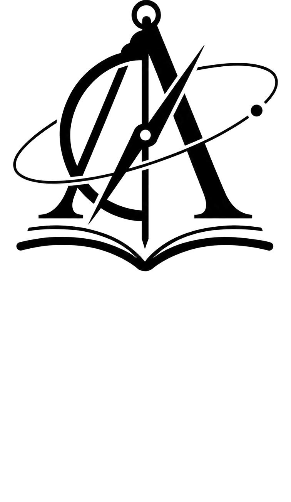

# Ars  Astronomica

A scholarly imprint producing first English translations of historical Hebrew and Latin works in astronomy, cosmology, and natural philosophy.

These texts span centuries, and most have never appeared in English. One -- Gersonides' 136-chapter mathematical astronomy -- was never printed and survives only in manuscript. They cite and answer one another, addressing the same cosmological questions, yet until now no one could read them side by side in a single language.

**[Browse all 62 works](/works/)** · **[Browse the 35 authors](/authors/)**

## Highlights

- [*Astronomiae Instauratae Progymnasmata*](/works/tycho-brahe-astronomiae-instauratae-progymnasmata/) (1602), [Tycho Brahe](/authors/tycho-brahe/). Solar and lunar theory, the best star catalogue before the telescope, and the new star of 1572, left unfinished and carried to press by Kepler.
- [*Sefer HaTechunah*](/works/levi-ben-gershom-sefer-hatechunah/) (c. 1328), [R. Levi ben Gershom (Gersonides)](/authors/levi-ben-gershom/). Astronomy built on the author's own instruments and observations, ready to overturn Ptolemy where measurement demands. Never printed.
- [*Almagestum Novum, Tomus Primus, Pars Prior*](/works/giovanni-battista-riccioli-almagestum-novum-tomus-primus-pars-prior/) (1651), [Giovanni Battista Riccioli](/authors/giovanni-battista-riccioli/). The Jesuit encyclopedia of astronomy: the sphere, Sun, Moon, eclipses, stars and planets, with the map whose crater names astronomers still use.
- [*Selenographia*](/works/johannes-hevelius-selenographia/) (1647), [Johannes Hevelius](/authors/johannes-hevelius/). The first lunar atlas drawn from systematic telescopic observation, the Moon night by night through its phases, engraved by the astronomer himself.
- [*Nechmad VeNa'im*](/works/david-gans-nechmad-venaim/) (c. 1613), [David Gans](/authors/david-gans/). A Hebrew textbook of astronomy by a man who visited Tycho Brahe's observatory, with the author's own preface restored from a single surviving prospectus.
- [*Rosa Ursina sive Sol*](/works/christoph-scheiner-rosa-ursina-sive-sol/) (1630), [Christoph Scheiner](/authors/christoph-scheiner/). The first comprehensive treatise on sunspots: proof that the Sun rotates, the tilt of its axis, and a quarrel with Galileo over who saw the spots first.
- [*Be'er HaGolah*](/works/judah-loew-ben-bezalel-beer-hagolah/) (1598), [R. Judah Loew ben Bezalel (Maharal)](/authors/judah-loew-ben-bezalel/). A defence of the Aggadah against critics who read its stories as absurd and its science as discredited, in seven 'wells' sunk toward one spring.
- [*Astronomia Danica*](/works/longomontanus-astronomia-danica/) (1622), [Longomontanus](/authors/longomontanus/). The fullest account of the Tychonic system, by the assistant who computed at Tycho's side, with tables, trigonometry, new stars and comets.

## About the translations

Every text is translated in full into fluent modern English -- nothing dropped, summarized, or invented -- with technical vocabulary anchored to its modern equivalents and mathematical content reproduced cell by cell and degree by degree. The PDFs are prepublication texts; the diagrams are still in progress.

These are **reading-grade** editions: complete and accurate in substance, good enough to work from and to read for pleasure, but not yet line-by-line verified against the printed page to the standard a scholar should cite. Eight works are further along: *Be'er HaGolah*, *Nechmad VeNa'im*, *Astronomia Reformata*, *Sefer HaTechunah*, *Astronomiae Instauratae Progymnasmata*, *De Mundi Aetherei Recentioribus Phaenomenis*, *Rosa Ursina sive Sol* and *Astronomia Danica* have been read complete against their sources and are **citation grade**. Quality is measured rather than asserted -- about one defect per thousand words on good Latin print, and some nine thousand numerals verified across Clavius's tables with essentially no misreadings.

[Read more about how the translations are made](https://arsastronomica.com/about/).

## Updates

**2026-11-27**

- Added *De Opere Dei Creationis* (Helisaeus Roeslin, 1597): a complete account of the created world in numbered theses, closing with the systems of Ptolemy, Copernicus, Ursus and Tycho set beside the author's own.

**2026-11-20**

- Added three works by Johannes Hevelius: the *Selenographia* (1647), the first lunar atlas drawn from systematic telescopic observation; the *Cometographia* (1668), the major survey of comets before Newton; and the first part of the *Machina Coelestis* (1673), his illustrated account of the instruments of the largest observatory in Europe after Uraniborg.
- Added the *Institutio Astronomica* (Pierre Gassendi, 1647), the standard astronomy textbook of its generation, which sets the Ptolemaic, Copernican and Tychonic systems side by side.
- Added the second part of Riccioli's *Almagestum Novum* (1651), Books VIII–X, with its 126 arguments for and against the Earth's motion.
- Each work's page now says when this is the first English translation, or the first complete one.

**2026-11-03**

- Added four works on the instruments of computation and observation around Tycho Brahe: his own *Triangulorum Planorum et Sphaericorum Praxis Arithmetica* (1591), the working manual of trigonometry behind the Uraniborg observations; the *Fundamentum Astronomicum* (Nicolaus Reimers Ursus, 1588), whose world system Tycho accused Ursus of stealing from him; and the *Observationes Hassiacae* (ed. Willebrord Snellius, 1618), the Kassel observations of Landgrave Wilhelm IV, the other great body of precision observation from before the telescope.
- Added the first part of Giovanni Battista Riccioli's *Almagestum Novum* (1651), Books I–VII, with the map of the Moon whose crater names astronomers still use.

[Earlier updates](https://arsastronomica.com/updates/)

## Support this project

> Upright reason dictates that the recipients of the good, of whatever type and level of beneficence it may be, must show gratitude and blessing to the beneficent person in every way possible, commensurate with the value of the beneficence. And one who has benefited all the people of the world -- for example, one who invented a new instrument for the good of the world, or a good book -- it is fitting for every discerning person, out of the obligation of love of fellow beings, to at least purchase it, so that the man will profit and his heart will be encouraged thereby to invent yet more good instruments in the world. And similarly, all other wise-hearted people will likewise strive and exert themselves to invent good things and instruments needed for the repair of the world and its perfection.
>
> And therefore, whoever says: "What do I need this new instrument for?" -- he does not act well towards the world. For if not for the man who invented it, where would you be? And what would your city do? And more than this, if the man did not exert himself, what would the world do?

R. Pinchas Eliyahu Hurwitz, _Sefer HaBris_

If you find these translations useful, you can [support me on Ko-fi](https://ko-fi.com/arsastronomica).

## Contact

- Email: **ArsAstronomica@protonmail.com**
- X: [@ArsAstronomica](https://x.com/ArsAstronomica)

## License

The original works are in the public domain and were obtained from a variety of sources, including digitized library collections and other open archives. No claim of ownership is made over the source texts.

All translations in this collection are © Scott Weisman. All rights reserved, except as granted by the license below.

The translations are made available under the [Creative Commons Attribution-NonCommercial-NoDerivatives 4.0 International](https://creativecommons.org/licenses/by-nc-nd/4.0/) license. You are free to share them for non-commercial purposes with attribution; you may not modify them or use them commercially without prior written permission.

## Acknowledgements

Translated with the assistance of Claude. The translator thanks the [Anthropic](https://www.anthropic.com) team for making this work possible.
